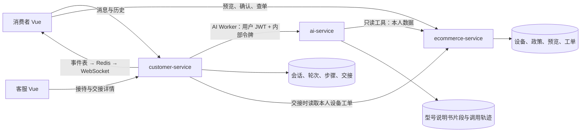

# 系统架构设计 · 独立评审稿

依据 [PRD v0.2](PRD.md)。下图描述拟实施架构。三个服务沿用各自的数据库会话和模型边界；跨服务通过 HTTP 传递身份和业务数据。两套 Vue 页面继续使用已有 REST 与 WebSocket 客户端。

## 从现有代码到新流程

| 边界 | 现有入口 | 设计改动 |
|---|---|---|
| 交易与归属 | [订单、售后及幂等处理](电商小二/ecommerce-service/ecommerce_service/main.py)、[业务模型](电商小二/ecommerce-service/ecommerce_service/models.py) | 使用新设备与维修实体。现有 AfterSale 按订单处理退换货，其规则继续服务原入口。保修和确认均由业务服务作最终判断。 |
| 会话协调 | [ChatService](电商小二/customer-service/atguigu/app/services/chat.py)、[AI Worker](电商小二/customer-service/atguigu/app/workers/ai.py) | 在已有消息、收集轮次、快照和插话检查上保存设备与步骤结果。冒烟分支在消息入口本地执行，模型不可用时仍可转接。 |
| Agent | [创建与中间件](电商小二/ai-service/atguigu/agent/agent.py)、[输出校验](电商小二/ai-service/atguigu/agent/harness/validator/validator.py) | 增设家电售后技能及只读工具。结构化输出携带证据和页面动作，服务端验证后回复。 |
| 知识 | [PDF 处理](电商小二/ai-service/atguigu/app/services/knowledge.py)、[管理路由](电商小二/ai-service/atguigu/app/routers/admin.py) | 为两个 DEMO 型号建立按章节和页定位的片段。先限制型号，再匹配故障码或症状。命中证据不足则返回空集。 |
| 前端与接待 | [用户端](电商小二/frontend/user-frontend/src/App.vue)、[管理端](电商小二/frontend/admin-frontend/src/App.vue)、[人工处理服务](电商小二/customer-service/atguigu/app/services/admin.py) | 在现有页面渲染设备选择、证据、单步反馈、预览确认和维修记录。客服详情展示结构化交接及已有工单。 |

## 三条关键链路

用户端提供「家电售后」入口，调用专用会话打开接口，由 customer-service 在创建时写入 APPLIANCE_SERVICE。普通聊天默认使用 ECOMMERCE。两个入口按用户和场景隔离；消息、历史和实时事件按会话 ID 定位。Worker 从持久化会话读取场景和版本，随经鉴权的内部 run 请求传递。ai-service 对 APPLIANCE_SERVICE 直接绑定同名技能，普通电商继续走现有 JEV 分类。[接口与状态契约](spec.md)

1. **诊断。** 聊天服务持久化用户消息，Worker 交付当前轮、有限历史和结构化状态。Agent 调用业务服务确认候选设备；设备明确后才能检索说明书。输出校验核对工具证据，客服服务只采纳仍是最新的轮次。聊天历史刷新可重建页面。
2. **写入。** Agent 返回打开预览的动作。浏览器以用户身份调用业务服务，获取与设备、描述和保修结论绑定的预览。明确点击确认后，业务服务在一个本地事务里校验并写入。丢失响应可重放。设计取舍见 [ADR-0001](docs/adr/0001-repair-confirmation.md)。
3. **交接。** 客服服务对会话加锁，一次提交转接原因、状态快照、等待记录与通知。工单由交易服务提供，读取失败不阻塞危险场景的立即转接。管理端打开详情时可重试查询。既有人工接单、回复、结束流程承载后续接待。

## 运行与失败边界

业务、客服和 AI 三套服务沿用 FastAPI、SQLAlchemy、PostgreSQL；Redis 用于实时通知。模型与 JEV 沿用现有适配器。AI 与客服各有同名 atguigu 包，按各自服务工作目录单独启动。测试配置显式指向隔离的 DEMO 数据库与 Redis；先处理 Redis 客户端中硬编码连接地址再联调。演示账号仅用于受控演示环境。

检索、业务工具读取失败时显示暂不可用，空集才表示资料无匹配。模型失败沿用有限重试与人工降级。WebSocket 断线后重新获取历史和本人维修记录。保留 trace_id、turn_id、命中片段 ID、耗时及错误码，访问令牌、内部令牌和完整用户描述从调试输出中移除。

数据设计见 [database.md](database.md)，接口和时序约束见 [spec.md](spec.md)。范围止于待受理工单与当前冒烟场景。

变更记录 · v0.2（2026-11-21）：明确双入口的可信路由、会话隔离及 Worker 传递边界。
